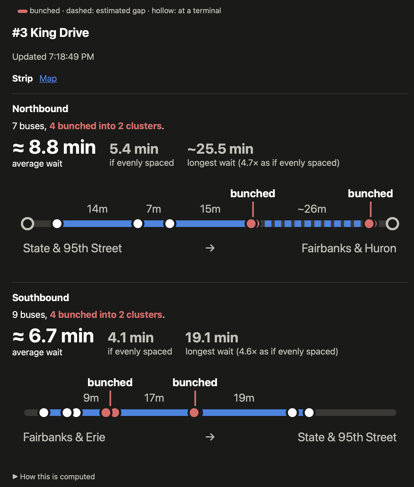
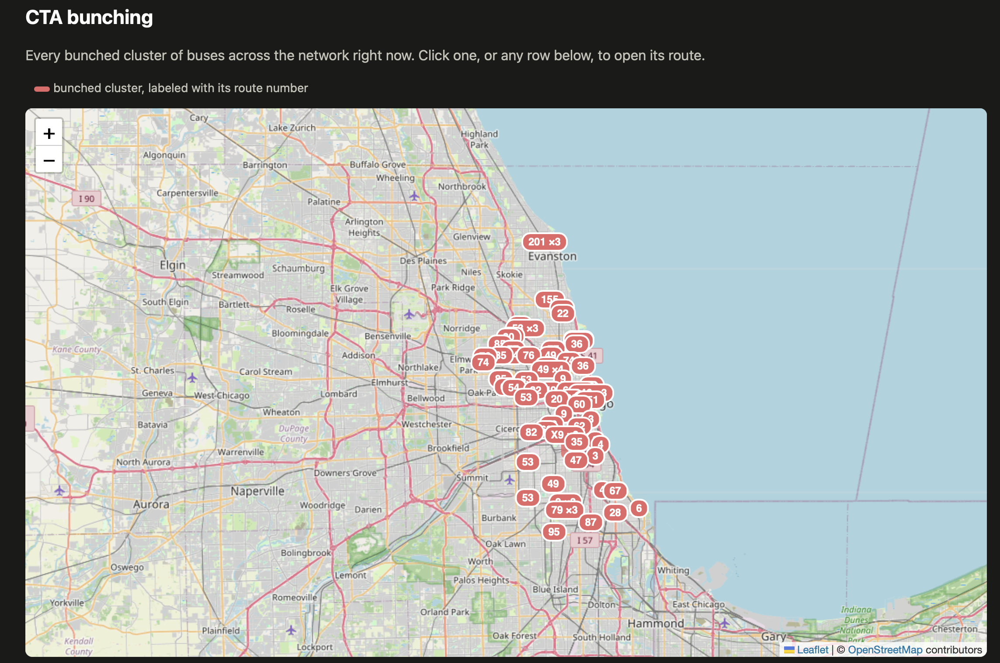
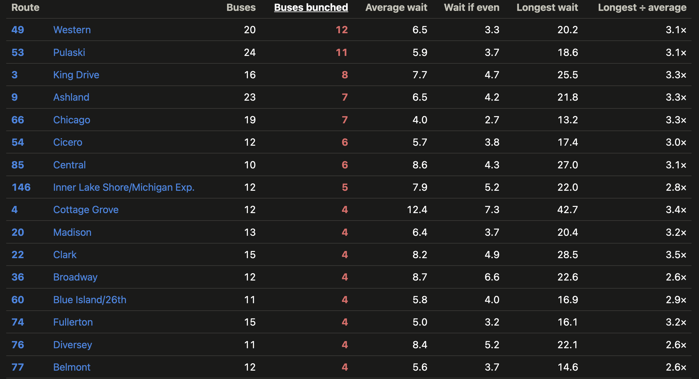

# go-cta

A Go client for the CTA [Bus Tracker](https://www.transitchicago.com/developers/bustracker/) and
[Train Tracker](https://www.transitchicago.com/developers/ttdocs/) APIs.

```go
client, err := cta.NewBusClientFromEnv() // reads CTA_BUS_API_KEY
if err != nil {
	panic(err)
}
preds, err := client.GetPredictionsByStopIds(ctx, []string{"1425"})
```

Create a `BusClient` (or `TrainClient`) from an API key, then call one method per endpoint: routes, directions, stops,
patterns, vehicles, predictions, detours and time (arrivals for trains). Methods take a `context.Context`, return
typed structs and surface API errors as Go errors. Helpers on the structs parse times and positions.
Optional settings are chained on the client: `WithLogger`, `WithHTTPClient`, `SpanishLocale`. API keys are redacted
from logs and errors.

Small runnable examples, one per endpoint, are in [`example/`](example), e.g.
`go run -tags predictions ./example/predictions.go`.

## Bus bunching

🚌 **CTA says bunching is not that bad, so here's a tool to show how bad it is.**

[`example/bunching`](example/bunching) is a small website built on the client. Pick a bus route and see where the
buses are, which ones are bunched together, and what the uneven spacing does to your wait.







### How bad is it?

During rush hour we often see:

- **20-30% of buses bunched**, and some routes have over half of their buses in bunches.
- **About 40% longer average waits** than if the same buses were evenly spaced.
- **The biggest gaps 3-5x as long** as they would be if buses were evenly spaced.

To run it, get a [Bus Tracker API key](https://www.transitchicago.com/developers/bustracker/), then from the repo root:

```sh
export CTA_BUS_API_KEY=your_key_here
go run ./example/bunching
```

Open http://localhost:8080. To try it without a key, add `-synthetic` for simulated buses.

Details on how it's computed are in its [README](example/bunching/README.md). A companion logger and analyzer for
observed headways is in [`example/bunchinglog`](example/bunchinglog).

## AI acknowledgement

The API client and the bunching logic were written without AI. The frontend code (HTML, JS, SVG rendering) was
written with AI and reviewed by a human.
