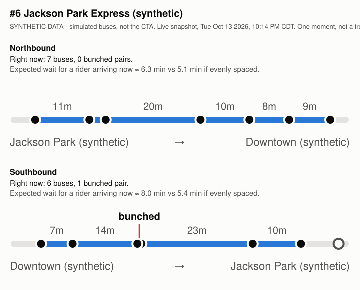

# Bus bunching, live

A small website built on go-cta. Pick any CTA bus route and see each direction as a strip with every bus on it,
the gaps between them, bunched pairs highlighted, and what that spacing does to your wait:

> Right now: N buses, X bunched pairs. Expected wait for a rider arriving now ≈ Y min vs Z min if evenly spaced.

One Go server (standard library only), one HTML file, no build step. Works on a phone.

## Running it

The key comes from `CTA_BUS_API_KEY`, same as the other examples.

```sh
export CTA_BUS_API_KEY=...
go run ./example/bunching                 # http://localhost:8080
go run ./example/bunching -addr :9000     # another port
go run ./example/bunching -synthetic      # simulated buses, no key needed
```

- `/` lists all routes (searchable)
- `/route/6` is the live view for #6, refreshed every 30 seconds. `/route/6,J14` shows several routes on one page (up to 4).
- `/route/6/snapshot.svg` and `/route/6/snapshot.md` download the current view as a picture and a short quick read.

Bus Tracker is only called for routes someone is viewing. Vehicle positions are cached for 30 seconds, route patterns
for 6 hours and the route list for a day, so many viewers cost the same as one and the daily request limit is safe.

## Snapshots

To save a snapshot without running the server:

```sh
go run ./example/bunching -snapshot 6 -out .     # writes snapshot-6.svg and snapshot-6.md
```

A snapshot is one moment, labeled with its time. It's good for showing what bunching looks like, not for
saying how bad it is on a route - for that you need many moments, see the logger below.

Example (**synthetic** - simulated buses from `-synthetic`, not CTA data):



## How it's computed

- **Position.** Every bus is placed along its direction's longest pattern by distance along the pattern: the API's `pdist`
  for buses on that pattern, projection of the GPS position onto it for buses on other variants (short turns etc.).
  Buses within 1000 ft of either end are treated as laying over (hollow dots) and left out of the numbers.
- **Gap in minutes.** The distance between consecutive buses divided by one speed per direction: the average of the
  speeds the buses report right now. Averaged over many buses - some stopped, some moving - that's roughly the running
  speed including stops. With fewer than 3 buses, or if they all report 0, it uses 10 mph. One speed for the whole direction
  keeps the gaps comparable: a bus waiting at a light doesn't make the gap behind it jump.
- **Bunched.** A gap under 2 minutes, or under 25% of the median gap in that direction, whichever is larger.
  The relative part matters on infrequent routes.
- **Expected wait for a rider arriving now.** E[H²] / (2·E[H]) over the current gaps H. A rider is more likely to show
  up during a long gap than a short one, so uneven spacing makes the average wait longer even with the same number of buses.
  **If evenly spaced** is E[H] / 2. The open-ended gaps ahead of the first bus and behind the last are not included.

Limitations: speeds are a rough estimate, gaps are "time for the bus behind to get where the bus ahead is now",
not true headways at a stop, and buses on a detour pattern far from the main pattern get projected onto it anyway.

## Logging and analyzing over time

`example/bunchinglog` logs vehicle positions to a JSONL file and computes observed headways at a few reference stops,
per route, direction and time of day (weekday AM peak, midday, PM peak, evening, overnight, weekend).

```sh
go run ./example/bunchinglog log -routes 6,55 -interval 60s     # appends to bunching-observations.jsonl, Ctrl-C to stop
go run ./example/bunchinglog analyze                            # prints the quick read, writes bunching-report.md and bunching-headways.svg
go run ./example/bunchinglog synth                              # a synthetic week to try the analyzer with
```

The logger keeps going on API errors and rate limits (logs them and backs off up to 15 minutes) and can be restarted
any time - it only ever appends. Headways that span a stretch with no data (logger down, no service) are dropped.
Same definitions as above, except headways are real passing times at a stop, interpolated between position reports.

Example quick read (**synthetic** - `bunchinglog synth`, not CTA data):

```
*** SYNTHETIC DATA - simulated buses, not a real finding ***

- #6 Northbound, weekday PM peak (3-7pm): average observed wait 4.9 min, versus 4.1 min if the same buses were evenly spaced; 4% of arrivals came within 2 min of the previous bus. (703 headways over 5 days, median headway 8.3 min.)
- #6 Southbound, weekday PM peak (3-7pm): average observed wait 4.9 min, versus 4.1 min if the same buses were evenly spaced; 5% of arrivals came within 2 min of the previous bus. (710 headways over 5 days, median headway 8.2 min.)
...
```

## Not done yet

- **L trains.** Train Tracker positions have no distance along a pattern, so trains would need projecting onto each
  line's station sequence. `buildLiveDirection` only needs positions along a line, so a train source can feed the same view.
- **Schedule comparison.** "If evenly spaced" compares against the same buses spread out, not against the schedule.
  Scheduled headways could come from the CTA GTFS feed.
